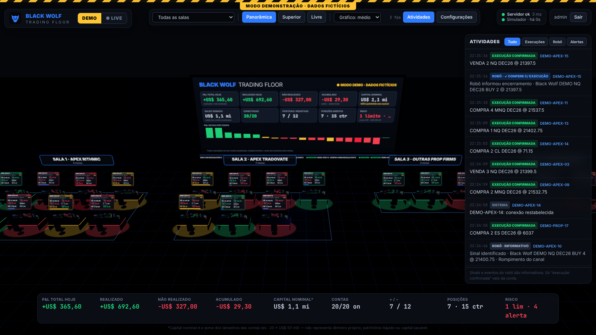
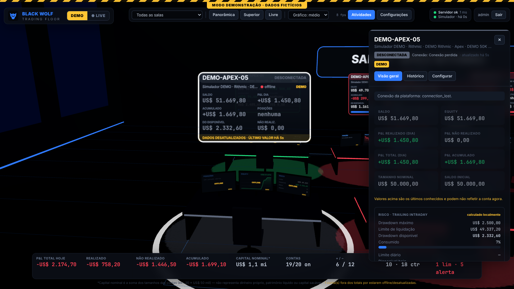
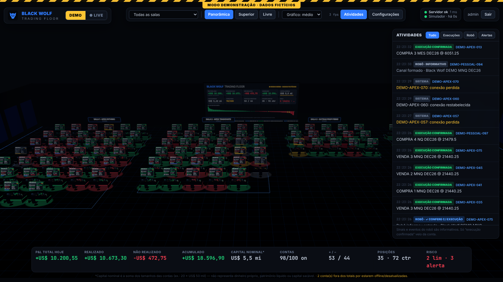

# BLACK WOLF TRADING FLOOR

Sala de trading virtual em 3D para **monitorar** contas de trading em tempo real. Cada mesa é uma
conta; o telão central consolida os números; um coletor dentro do NinjaTrader 8 alimenta os dados.

**É somente monitoramento: o sistema não envia, altera nem cancela ordens, e nunca pede senha de corretora.**



---

## Situação de cada parte (honesta)

| Parte | Situação |
|---|---|
| Sala 3D (mesas, monitores, telão, setores, iluminação, câmeras) | ✅ implementada e testada no navegador (Chromium) |
| Cores por estado (verde/vermelho/amarelo/cinza, risco com prioridade) | ✅ implementada e coberta por testes |
| Painel central, resumo, feed de atividades, painel da conta com gráfico e filtro de período | ✅ implementado e testado ponta a ponta |
| Modo DEMO (20 contas fictícias, configurável até 100+) | ✅ implementado e testado |
| Backend (Fastify + WebSocket + PostgreSQL), autenticação, tokens | ✅ implementado; 64 testes automatizados passando (inclui Postgres real) |
| Tempo real: incremental, heartbeat, latência, reconexão, retomada sem perda, deduplicação, dados atrasados | ✅ implementado e testado |
| Salas/setores, mover/renomear/reordenar/cadastrar contas, configuração persistente | ✅ implementado e testado |
| Regras de risco configuráveis por conta (estático, trailing intraday, trailing EOD, perda diária) | ✅ implementado e testado |
| Integração com o robô (endpoint + helper C#) | ✅ implementada e testada contra o servidor; **helper não compilado dentro do NT8** |
| Coletor NinjaTrader 8 (C#) | 🟡 **escrito, compilado com Mono contra stubs da API e testado contra o servidor real. Ainda NÃO compilado/executado num NinjaTrader 8 real** (precisa de Windows) |
| ETAPA 7 — validação com uma conta real | ⏳ **pendente** — depende de você rodar no seu PC (roteiro em [docs/NINJATRADER.md](docs/NINJATRADER.md#6-etapa-7--validar-uma-conta-antes-de-expandir)) |

---

## Arquitetura

```
 NinjaTrader 8 (Windows)                     Servidor local (Node.js)                    Navegador
┌───────────────────────────┐  HTTP POST   ┌──────────────────────────────┐  WebSocket ┌────────────────────┐
│ AddOn BlackWolfFloor-     │ ~1×/s +token │ Fastify                      │  snapshot  │ React + Three.js   │
│ Collector (somente leitura)├────────────►│  /api/ingest/nt8  ──┐        │  + eventos │ (React Three Fiber)│
│  Account.All, Positions,  │              │                     ▼        ├───────────►│ Sala 3D, telão,    │
│  Orders, ExecutionUpdate  │              │  Motor LIVE  ─┐  Motor DEMO   │  seq/epoch │ painéis, feed      │
└───────────────────────────┘              │  (risco,      │  ◄─ simulador │  heartbeat │                    │
 Robô Black Wolf ── POST /api/ingest/robot►│   frescor,    │     DEMO      │            └────────────────────┘
                                           │   dedupe)     ▼               │
                                           │  PostgreSQL (config + histórico LIVE)        │
                                           └──────────────────────────────┘
```

- `shared/` — tipos, validação (zod) e motor de risco usados no servidor e no navegador.
- `server/` — API, WebSocket, motores LIVE/DEMO, simulador, PostgreSQL. Escuta só em `127.0.0.1`.
- `web/` — React + TypeScript + Vite + Three.js + React Three Fiber + Drei + Tailwind.
- `collector-nt8/` — AddOn C# (NinjaScript) e helper de eventos do robô.
- `docs/` — [NinjaTrader](docs/NINJATRADER.md), [robô](docs/ROBO.md), [segurança](docs/SEGURANCA.md).

**Por que PostgreSQL com `pg` e SQL puro em vez de Prisma:** o esquema é pequeno (8 tabelas), as
consultas são simples e o Prisma traz um binário de engine por plataforma que complica a instalação
local no Windows. As migrações estão em `server/src/db/migrations/`. Sem `DATABASE_URL` o servidor
roda **em memória** (útil para testar o DEMO; nada persiste).

---

## Instalação (Windows)

Pré-requisitos: **Node.js 22.9+** (https://nodejs.org) e **PostgreSQL 16** (instalador oficial, ou
Docker com `docker-compose.yml`).

```powershell
cd trading-floor
copy .env.example .env          # edite DATABASE_URL com a senha do seu Postgres
npm install
npm run db:migrate              # cria as tabelas
npm run build                   # compila a interface
npm start                       # http://127.0.0.1:4100
```

Criar o banco no Postgres (uma vez), no `psql` ou pgAdmin:

```sql
CREATE USER blackwolf WITH PASSWORD 'uma-senha-forte';
CREATE DATABASE blackwolf_floor OWNER blackwolf;
```

Ou com Docker: defina `POSTGRES_PASSWORD` no `.env` e rode `docker compose up -d`.

**Primeiro acesso:** abra http://127.0.0.1:4100 no próprio PC e crie o usuário e a senha do painel
(mínimo 10 caracteres). Alternativa: `npm run user:set-password -- --user admin`.

### Comandos

| Comando | O que faz |
|---|---|
| `npm start` | servidor + interface compilada em http://127.0.0.1:4100 |
| `npm run dev` | desenvolvimento: servidor com recarga + Vite em http://127.0.0.1:5173 |
| `npm run build` | compila a interface (`web/dist`) |
| `npm test` | testes do servidor (para incluir o Postgres: `TEST_DATABASE_URL=… npm test`, use um banco descartável) |
| `npm run typecheck` | checagem de tipos dos 3 pacotes |
| `npm run test:e2e` | teste ponta a ponta no navegador (requer servidor rodando, `BW_PASS` e Playwright) |
| `npm run collector:check` | garante que o coletor não usa API de ordens e compila com Mono (Linux/macOS) |
| `npm run token:create -- --name pc --kind nt8` | cria token do coletor (`--kind robot` para o robô) |
| `npm run db:migrate` | aplica migrações |

Variáveis úteis: `BW_DEMO_ACCOUNTS=100` (tamanho do DEMO), `BW_DISABLE_DEMO=1`,
`BW_STALE_AFTER_MS=5000` (tempo sem dados até marcar "desatualizada").

---

## Usando a sala



- **DEMO / LIVE** no canto superior esquerdo. DEMO tem faixa amarela listrada e "DADOS FICTÍCIOS"
  em todo lugar (telão, painéis, monitores). LIVE pede confirmação. Trocar de modo descarta todo o
  estado do modo anterior — os dois nunca se misturam (são motores, canais e salas separados).
- **Câmeras:** Panorâmica, Superior e Livre (arraste para girar, botão direito move, roda aproxima,
  **W A S D** anda, **Q/E** sobe/desce, **Shift** acelera). Clique numa mesa para focar e abrir o painel.
  **Esc** fecha.
- **Cores:** cinza = desconectada/desatualizada/sem dados · vermelho pulsante = limite atingido ·
  amarelo = perto do limite (padrão 75% consumido, configurável) · verde = lucro · vermelho = prejuízo
  · azul = zerada. **Risco tem prioridade sobre lucro**; falta de dados tem prioridade sobre tudo.
- **Dados desatualizados:** sem atualização do coletor por 5 s, a mesa fica cinza, os valores
  aparecem esmaecidos com "ÚLTIMO VALOR HÁ Xs" e **saem dos totais** do telão. Se o navegador perder
  o servidor, a sala inteira é marcada como congelada.
- **Capital nominal** = soma dos tamanhos das contas (20 × US$ 50 mil = US$ 1 mi). Está sempre
  rotulado como **não sendo** patrimônio, saldo próprio ou valor sacável. Saldo, equity, drawdown e
  P&L realizado são mostrados separados.
- **Painel da conta:** Visão geral (saldo, equity, P&L realizado/não realizado/total/acumulado,
  risco, posições, ordens, instrumentos, campos que a conexão informa), Histórico (gráfico de
  equity/saldo, execuções e eventos com filtro Hoje/7d/30d/Tudo/período) e Configurar.
- **Configurações:** Contas e mesas (renomear, mover de sala, reordenar ▲▼, ocultar, remover,
  cadastrar), Salas (criar/renomear/ordenar/excluir), Integrações (tokens) e Limitações.
- **Qualidade gráfica:** leve / médio / alto (alto liga sombras, reflexo no piso e bloom).
  O contador de **fps** fica ao lado do seletor.

### Regras de risco

Configuráveis **por conta** (aba Configurar), com modelos opcionais que são apenas pontos de partida:

- **Estático:** limite = saldo inicial − drawdown.
- **Trailing intraday:** limite = maior equity observado − drawdown, parando em saldo inicial + X.
- **Trailing EOD:** igual, mas o pico só sobe com o saldo no horário de fechamento configurado
  (aplicado só se o app estava aberto até 60 min depois do fechamento).
- **Perda diária:** compara o P&L total do dia com o limite.
- **Limite atual informado manualmente** (recomendado): copie o valor do dashboard da prop firm;
  o app nunca o rebaixa, só o sobe com o trailing.

> ⚠️ As regras da Apex mudaram em mar/2026 (novas contas EOD e Intraday; contas legadas seguem regras
> antigas) e fontes públicas divergem nos valores. Por isso **nenhuma regra vem pré-configurada** para
> contas LIVE: confira no dashboard da sua prop firm e preencha conta a conta.

---

## Conectar contas reais (resumo)

1. `npm start` e entre no painel.
2. **Configurações → Integrações → Gerar token** (tipo *Coletor NinjaTrader 8*).
3. Copie `collector-nt8/BlackWolfFloorCollector.cs` para `Documentos\NinjaTrader 8\bin\Custom\AddOns\`
   e compile com **F5** no NinjaScript Editor.
4. Preencha o token em `Documentos\NinjaTrader 8\BlackWolfFloor\collector.config` (criado na primeira
   execução) e, para a ETAPA 7, coloque **uma** conta em `includeAccounts`. Recompile.
5. Mude o painel para **LIVE**, configure a conta e faça a validação lado a lado com o NinjaTrader.

Passo a passo completo, tabela do que é coletado e checklist de validação: **[docs/NINJATRADER.md](docs/NINJATRADER.md)**.
Robô Black Wolf: **[docs/ROBO.md](docs/ROBO.md)**.

---

## Testes executados

- **Servidor (vitest, 64 testes):** motor de risco (estático, trailing com teto, EOD com janela,
  limite manual, perda diária, prioridade de cores); motor (descoberta de contas, campos ausentes =
  `null`, pacote duplicado, snapshot atrasado, reinício do coletor, dedupe de execuções, conta
  desatualizada sai dos totais, conta sumida = desconectada, capital nominal, reorganização de salas);
  robô (nunca confirmado, dedupe, correlação por `orderId`, sinal ≠ operação); segregação DEMO/LIVE;
  API (401 sem sessão, login sem oráculo, cookie HttpOnly/SameSite, sessão e tokens só como hash,
  CSRF, cabeçalhos, escopo dos tokens, revogação, validação 400); WebSocket (401/403, snapshot,
  incremental, **retomada sem perda após reconexão**, ping/pong); PostgreSQL real (migração
  idempotente, separação por modo, `ON CONFLICT`, recusa de dados DEMO).
- **Ponta a ponta (Playwright/Chromium):** login, dados DEMO via WebSocket, câmeras, **clique numa
  mesa dentro da cena 3D**, painel/histórico/configuração da conta, configurações, qualidade alta,
  troca para LIVE sem vazar DEMO, sem erros no console.
- **Coletor C# (Mono):** compila contra stubs; harness com contas simuladas enviou para o servidor
  real — `Sim101` excluída, posição zerada e ordem executada ignoradas, aspas escapadas, execuções
  deduplicadas, assinaturas não duplicam em recompilação e são removidas no encerramento, token não
  aparece no log. Helper do robô: eventos chegam como informativos, evento inválido é descartado sem
  travar a fila.
- **Escala:** 100 contas DEMO renderizadas. Num Chromium **sem GPU** (renderização por CPU) foram
  2,5 fps com 100 mesas e 3,8 fps com 20 — números que **não** representam um PC com placa de vídeo;
  meça no seu com o contador de fps. As otimizações (instancing, agendador de texturas com orçamento
  por frame, telão limitado a 1×/s, monitores em 1 malha) fizeram 100 mesas ficarem 3,6× mais
  rápidas no mesmo ambiente.



---

## Limitações técnicas e pendências

**Dependem do NinjaTrader / das conexões (não há como o app resolver sozinho):**

- O NinjaTrader **não expõe** o trailing drawdown/limite de liquidação da prop firm. O app calcula
  localmente ou usa o valor que você informa. Antes de o app existir, o histórico é desconhecido.
- Quais itens de conta (saldo, P&L realizado…) cada conexão preenche não é garantido pela
  documentação; o painel mostra "—" para o que não chega, e lista os campos recebidos.
- A janela do "P&L realizado do dia" é a da conexão/NinjaTrader — precisa ser conferida na ETAPA 7.
- P&L não realizado por posição exige cotação ativa do instrumento no NinjaTrader.
- Contas Tradovate usadas só na plataforma web (fora do NinjaTrader) não são vistas pelo coletor.
- Latência: ~1 s quando a fonte envia; não há garantia (depende do NT8, da conexão e do PC).

**Pendências do projeto:**

- Compilar e executar o coletor e o helper do robô **dentro do NinjaTrader 8** (Windows) e fazer a
  ETAPA 7 com uma conta real.
- Instrumentar o código-fonte do robô Black Wolf com as chamadas de evento (o robô é distribuído
  compilado).
- Histórico LIVE começa quando o coletor passa a enviar; não há importação de histórico da corretora.
- Arrastar mesas diretamente na cena 3D (hoje a reorganização é pela tela de Configurações).
- Um único usuário administrador (sem papéis/permissões múltiplas).
- Horários de execução assumem que o fuso do NinjaTrader é o mesmo do Windows.
- Desempenho com GPU real ainda não medido (só em renderização por CPU).
- Retenção/limpeza automática do histórico no Postgres (pontos de equity a cada 15 s por conta).
